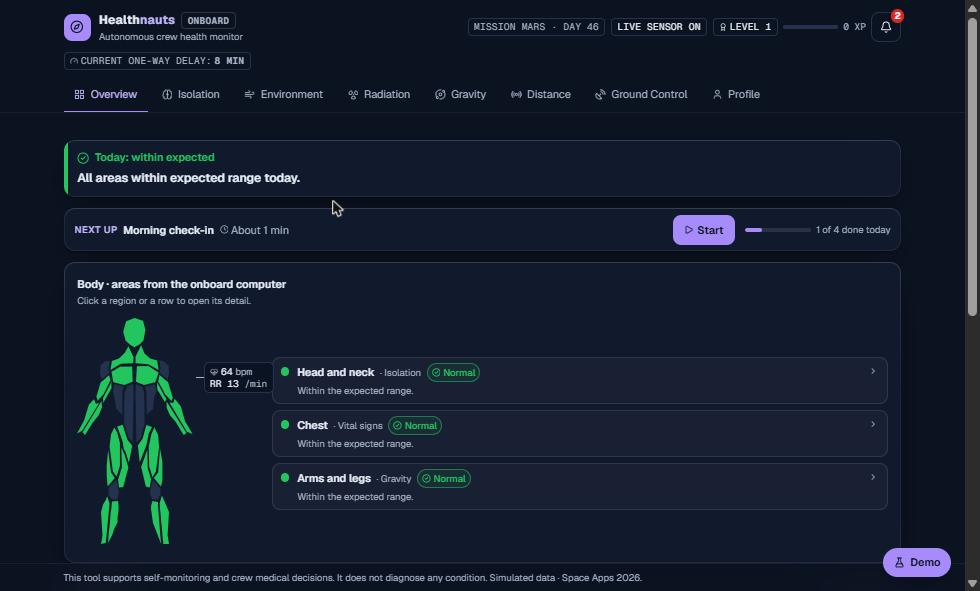
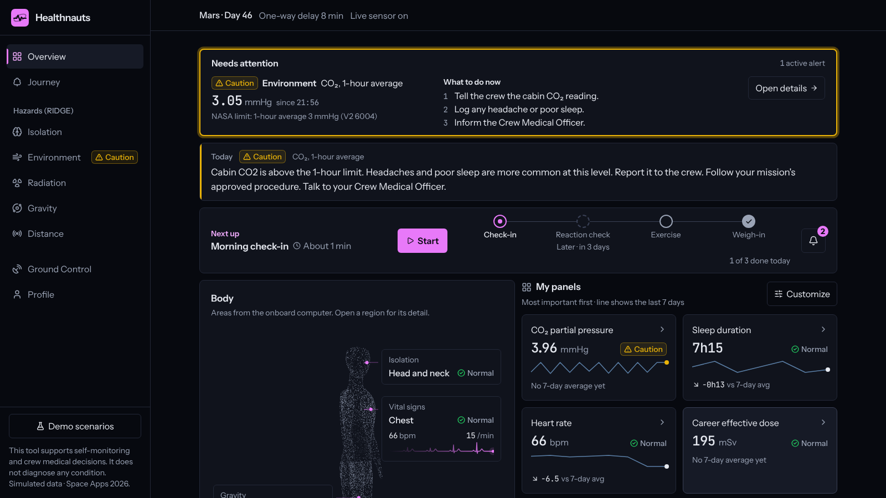
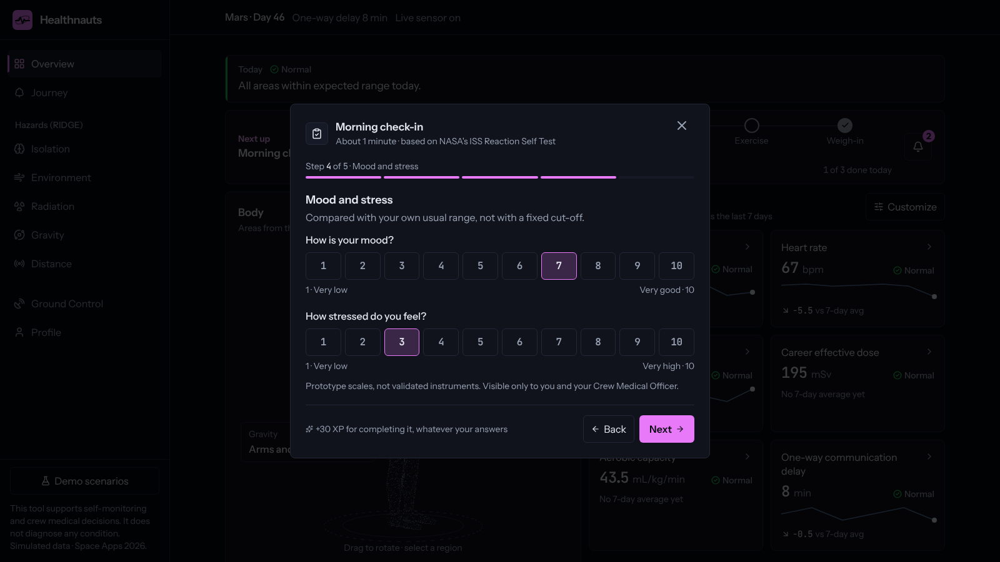
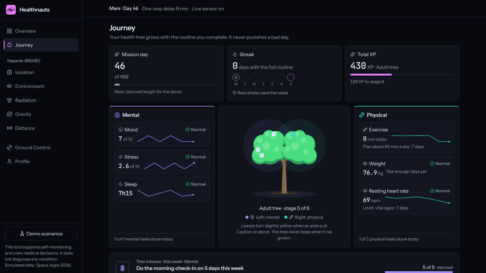
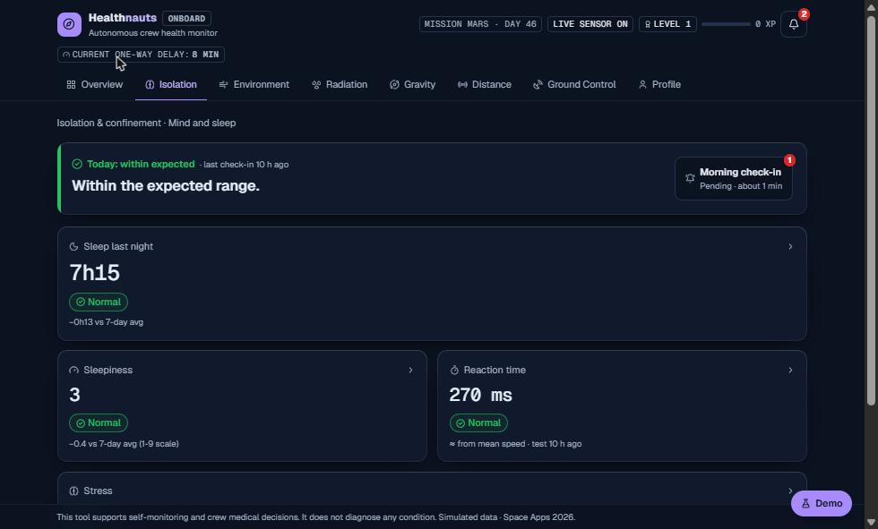
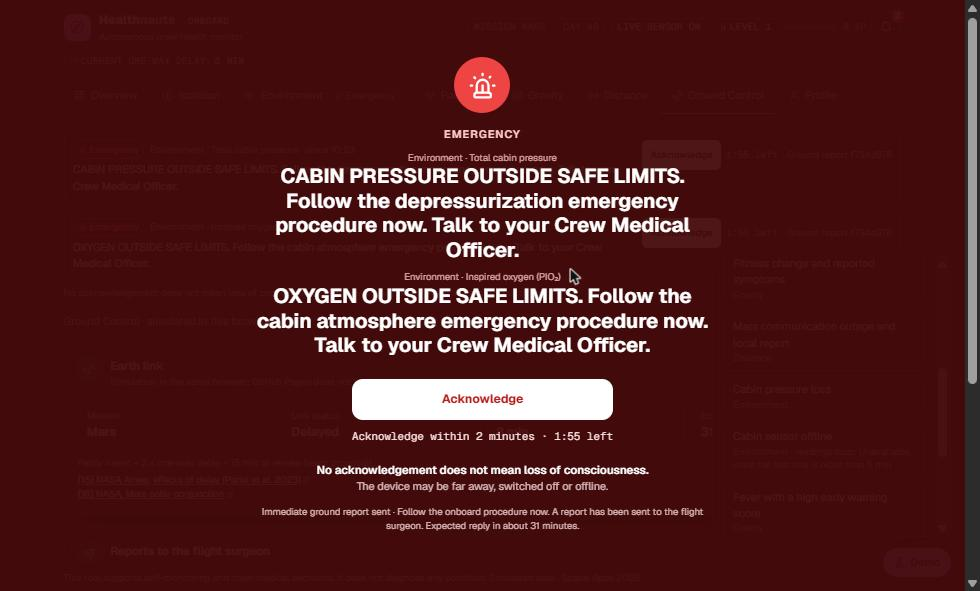
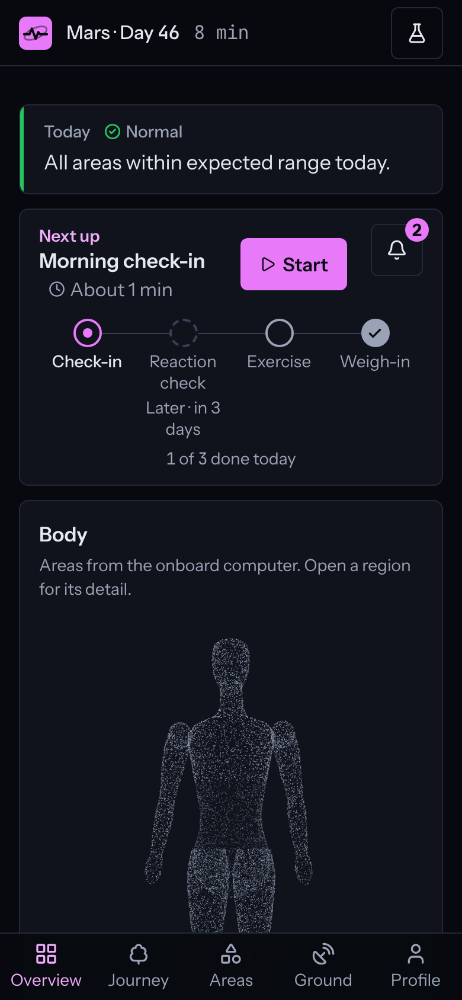

# Healthnauts

> Daily crew health monitoring for long space missions, so astronauts can spot problems early and act on their own when Earth is minutes away.

**Live app:** https://mendezinxd.github.io/NasaSpaceAppsChallenge2026/
**Challenge:** NASA Space Apps Challenge 2026, "Create Health Monitoring Software for Astronauts on Space Missions"
**Team:** Black Belt's Team, Ouro Preto, Brazil

All data in the demo is simulated. Healthnauts supports self-monitoring and crew medical decisions. It does not diagnose any condition.



## The problem

In January 2026, NASA ended the Crew-11 mission about a month early because of a crew member's health, a first in NASA's history. Near Earth, a crew can come home. On the way to Mars, a message takes up to 22 minutes each way and evacuation is not possible. Crews will need to notice health problems early and respond without real-time help from the ground.

NASA groups the hazards of spaceflight into five categories, **RIDGE**: space **R**adiation, **I**solation and confinement, **D**istance from Earth, **G**ravity fields and hostile/closed **E**nvironments. Healthnauts is organized around these five hazards.

## What it does

- **The day at a glance.** One sentence about today, a "Next up" routine, a 3D body to open each area and up to 10 panels the astronaut chooses.
- **Alerts with NASA limits.** Five levels (Normal, Advisory, Caution, Warning, Emergency) plus Unavailable, always with icon and text. Each value is compared with its NASA-STD-3001 limit.
- **What to do now.** Every alert shows short next steps and opens the full details in one tap. Steps follow published NASA sources where they exist; otherwise the app says it is general guidance and points to the Crew Medical Officer.
- **Emergency with acknowledgement.** Vehicle safety conditions (cabin pressure, oxygen) open a full screen alert with a countdown. If no one acknowledges, it escalates to the Crew Medical Officer and a report goes to Earth.
- **Daily routine.** A 1-minute morning check-in in steps (sleep, sleepiness, fatigue, mood and stress), a reaction time test (PVT-B), exercise and weigh-in.
- **Journey (gamification).** A health tree that grows with the tasks the astronaut completes. XP rewards doing, never the result, and the tree never dies. Weekly missions add flowers and fruits.
- **Report to Earth with the real delay.** Reports move from queued to replied, with the reply time based on the current one-way delay.

| Alert with next steps | Morning check-in |
|---|---|
|  |  |

| Journey | Isolation (mind and sleep) |
|---|---|
|  |  |

| Emergency | Mobile |
|---|---|
|  |  |

The Journey screenshot uses demo XP so the tree is shown grown. A new user starts from a seed.

## NASA data and scientific basis

- **NASA-STD-3001 Vol. 2 Rev. F (2026):** cabin limits such as 1-hour ppCO₂ no more than 3 mmHg [V2 6004], inspired O₂ [V2 6003], cabin pressure [V2 6006], temperature and humidity [V2 6012], noise [V2 6077].
- **NASA-STD-3001 Vol. 1 Rev. C:** career radiation limit (600 mSv), sleep and medical operations.
- **NASA Human Research Program** risks (RIDGE) and **OCHMO technical briefs** (CO₂, atmosphere, acoustics, decompression sickness).
- **NASA Standard Measures** and the ISS **Reaction Self Test**, the basis for the check-in and the PVT-B.
- **Validated scales** where NASA publishes no number: Karolinska Sleepiness Scale, Samn-Perelli fatigue scale, PVT-B, NEWS2 (labeled as a terrestrial reference).

Every limit in the code is tied to a source or marked as a team proposal. Audit: [`docs/verificacao.md`](docs/verificacao.md).

## Try the demo

Open the [live app](https://mendezinxd.github.io/NasaSpaceAppsChallenge2026/) and press **Demo scenarios**. Each scenario writes simulated data and the real alert rules react: elevated cabin CO₂, solar event, a week of short sleep, fitness change, Mars communication outage, cabin pressure loss (Emergency), sensor offline, fever and exercise. **Back to nominal** and **Reset demo** start over.

## Run it locally

Requires [Node.js](https://nodejs.org/) 22+ and Git.

```bash
git clone https://github.com/mendezinxd/NasaSpaceAppsChallenge2026.git
cd NasaSpaceAppsChallenge2026
npm install
npm run dev        # open the address shown (usually http://localhost:5173)
npm test           # 104 automated tests
```

On Windows machines that block PowerShell scripts, use `npm.cmd` instead of `npm`. Every push to `main` runs the tests and publishes the site to GitHub Pages.

## Architecture

```
shared/   Rules in plain JavaScript (levels, alerts, ground reports, scenarios). Runs in the browser and in Node.
src/      React + TypeScript front-end (Vite, Tailwind, Recharts, Framer Motion, Zustand, three.js).
server/   Optional Express server with the same rules, standing in for the onboard computer.
test/     Automated tests.
docs/     Specification, verification audit, screenshots.
```

The interface never decides a level by itself: all levels and messages come from `shared/`. The published site runs the rules in the browser, so it works as a static page without a connection to Earth.

## Limitations

- All data is simulated. There is no connection to real sensors and the app has not been tested with astronauts.
- Mood, stress and sleep quality use prototype 1 to 10 scales, not validated instruments.
- Some rules from the specification are not implemented yet (see `docs/verificacao.md`).
- Browser storage is not secure access control. Privacy of health data is a design proposal.
- Next steps: Crew Medical Officer view, wearable and tablet versions, and validation with aerospace medicine professionals.

## Use of AI

- The idea, research questions, indicators, alert design and product decisions were made by the team.
- AI assistants (Anthropic Claude, including Claude Code) helped with brainstorming, research, the specification, code and debugging, writing and translation, visual design and the 30-second demo video, always under the team's direction. All code was reviewed and tested by the team.
- Visual design: the interface, the logo mark and the health tree were coded as SVG and CSS with AI assistance and reviewed by the team. No AI image generators were used.
- The demo video shows real screen recordings of the app and carries a visible "edited with AI assistance" watermark. No NASA logos, flags or mission identifiers are used.

## Team

Black Belt's Team, Ouro Preto (Brazil): Samuel (front-end), Bernardo (back-end), Adriane (radiation and distance), Matheus (isolation and confinement), Rafael (gravity fields), Augusto (closed environments).

## References

**NASA**

- NASA-STD-3001 Vol. 2 Rev. F (2026): https://standards.nasa.gov/system/files/tmp/NASA-STD-3001%20Vol%202%20Rev%20F.pdf
- NASA-STD-3001 Vol. 1 Rev. C: https://standards.nasa.gov/sites/default/files/standards/NASA/C//nasa-std-3001-vol-1-rev-c-signature.pdf
- NASA-STD-3001 Vol. 1, Medical Operations: https://www.nasa.gov/reference/6-0-medical-operations/
- NASA-STD-3001 Vol. 2, Natural and Induced Environments: https://www.nasa.gov/reference/6-0-natural-and-induced-environments-vol-2
- NASA, Human Health and Performance on a Mission to Mars: https://ntrs.nasa.gov/api/citations/20230015521/downloads/Human%20Health%20and%20Performance.pdf
- NASA, Development of Medical Capabilities and Technologies: https://ntrs.nasa.gov/api/citations/20210023828/downloads/Decadal%20Topical%20-%20Development%20of%20Medical%20Capabilities%20and%20Technologies_New%20Graphic.docx.pdf
- OCHMO-TB-004 Carbon Dioxide: https://www.nasa.gov/wp-content/uploads/2023/12/ochmo-tb-004-carbon-dioxide.pdf
- OCHMO-TB-003 Habitable Atmosphere: https://www.nasa.gov/wp-content/uploads/2023/12/ochmo-tb-003-habitable-atmosphere.pdf
- OCHMO Acoustics technical brief: https://www.nasa.gov/sites/default/files/atoms/files/acoustics_technical_brief_ochmo_0.pdf
- Goodman, spacecraft acoustics: https://ntrs.nasa.gov/api/citations/20090043801/downloads/20090043801.pdf
- OCHMO Decompression Sickness technical brief: https://www.nasa.gov/sites/default/files/atoms/files/dcs_technical_brief_ochmo.pdf
- NASA OSDR Environmental Data App: https://visualization.osdr.nasa.gov/eda
- NASA SRAG, ISS radiation operations: https://www.nationalacademies.org/cdn/materials/9fba0b8d-da37-49fe-9fc5-45b736630da3
- NASA RadWorks, solar event shelter: https://ntrs.nasa.gov/api/citations/20150001237/downloads/20150001237.pdf
- Parisi et al. 2024, communication delay (NASA Ames): https://ntrs.nasa.gov/api/citations/20240006867/downloads/Proof_Slides_Parisi_Megan_969.pdf
- Parisi et al. 2023, effects of communication delay (NASA Ames): https://ntrs.nasa.gov/api/citations/20230010972/downloads/Proof_Slides_Parisi_Megan_797.pdf
- NASA, Mars solar conjunction: https://mars.nasa.gov/mars2020/mission/status/337/hunkering-down-for-solar-conjunction
- NASA, medical risk on a long lunar mission: https://ntrs.nasa.gov/api/citations/20240011063/downloads/Quantifying%20Risk%20on%20a%20Long%20Duration%20Lunar%20Mission.pdf
- NASA, ISS ocular surveillance: https://ntrs.nasa.gov/api/citations/20170009173/downloads/20170009173.pdf
- NASA HRP risks: cardiovascular (https://www.nasa.gov/reference/risk-of-cardiovascular-adaptations/), bone (https://www.nasa.gov/reference/risk-of-spaceflight-induced-bone-changes/), SANS (https://www.nasa.gov/reference/risk-of-spaceflight-associated-neuro-ocular-syndrome-sans/)
- NASA Standard Measures: https://www.nasa.gov/reference/standard-measures/
- NASA BHP Standard Measures: https://ntrs.nasa.gov/api/citations/20170005421/downloads/20170005421.pdf
- Reaction Self Test on the ISS: https://pmc.ncbi.nlm.nih.gov/articles/PMC8919197
- Arsintescu et al. 2019, NASA Ames (KSS, Samn-Perelli): https://hsi.arc.nasa.gov/publications/Arsintescu_etal_2019_JoVE.pdf
- NASA Spinoff 2013, Reaction Self Test: https://spinoff.nasa.gov/Spinoff2013/hm_1.html
- NASA, lessons from astronauts on isolation: https://www.nasa.gov/humans-in-space/isolation-what-can-we-learn-from-the-experiences-of-nasa-astronauts/
- NPR, Crew-11 returns early after medical evacuation: https://www.npr.org/2026/01/15/nx-s1-5677647/nasa-spacex-crew-11-splashdown-return

**External**

- Norsk et al. 2015, J Physiol: https://doi.org/10.1113/jphysiol.2014.284869
- Orthostatic hypotension (MSD Manual): https://www.msdmanuals.com/professional/cardiovascular-disorders/symptoms-of-cardiovascular-disorders/orthostatic-hypotension
- NEWS2, Royal College of Physicians: https://www.rcp.ac.uk/resources/national-early-warning-score-news-2/
- Karolinska Sleepiness Scale (Åkerstedt and Gillberg, 1990)
- Samn-Perelli fatigue scale, USAF SAM-TR-82-21: https://apps.dtic.mil/sti/pdfs/ADA125319.pdf
- Basner, Mollicone and Dinges 2011, PVT-B: https://www.med.upenn.edu/uep/assets/user-content/documents/Basner2011-ValidityandsensitivityofabriefPVT.pdf
- ESA, communication latency study: https://nebula.esa.int/sites/default/files/neb_study/3142/C4000136202FR.pdf
- 3D particle body adapted from possato-a/healthnauts-preview, used with permission; three.js (MIT)

Open source libraries are listed in `package.json`, each under its own license.
